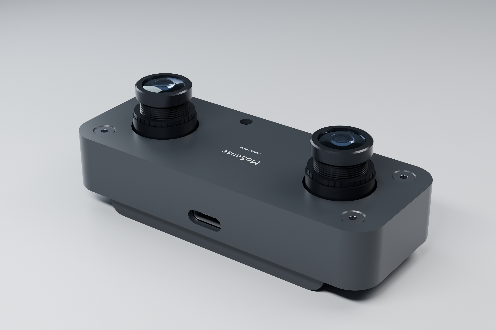
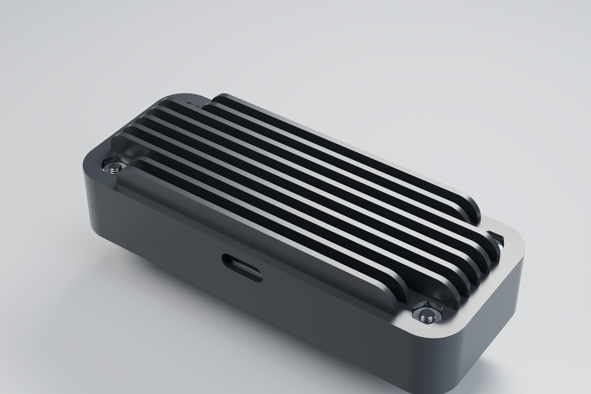
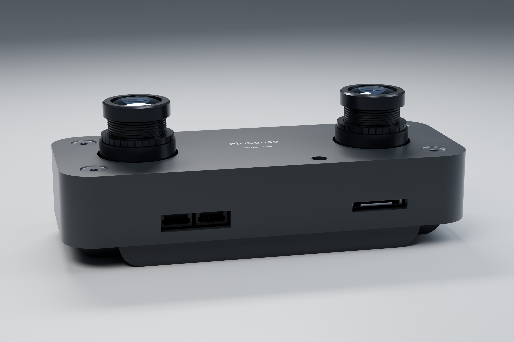
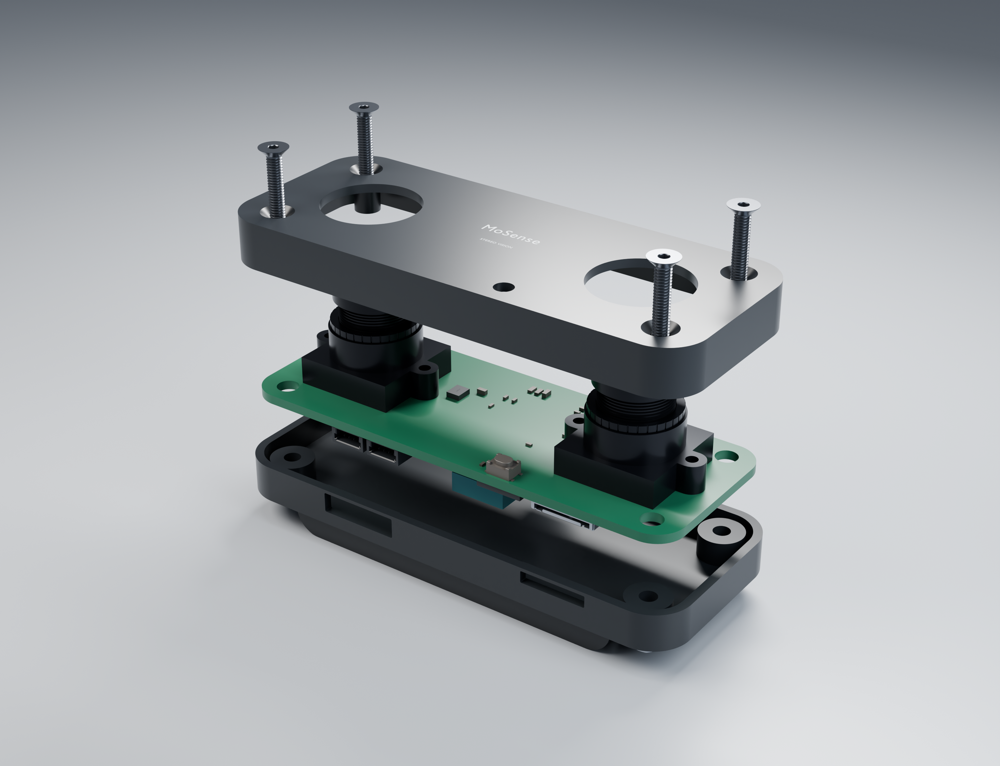
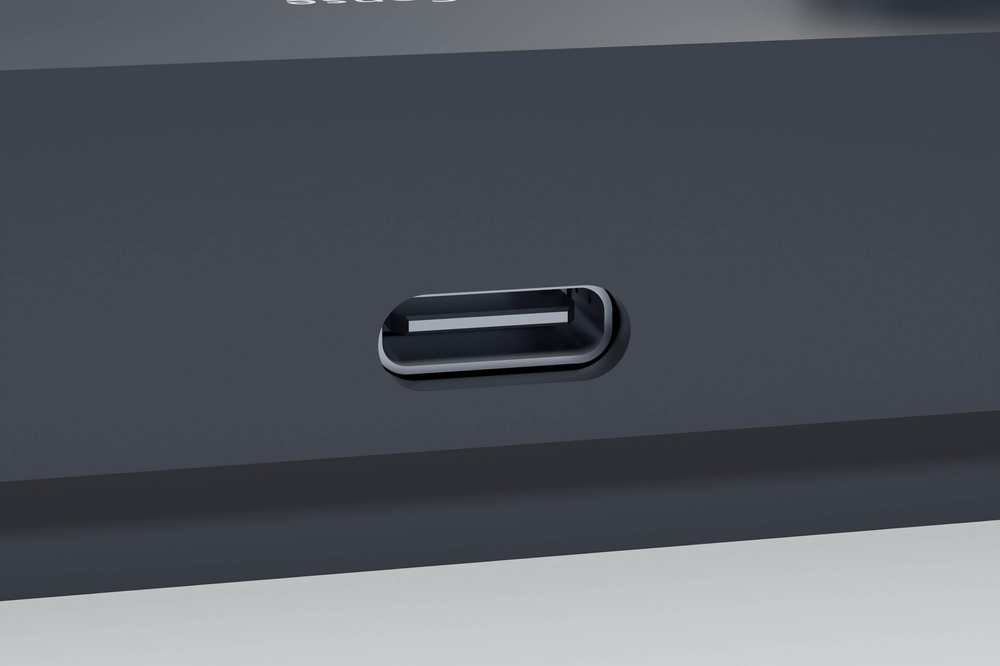
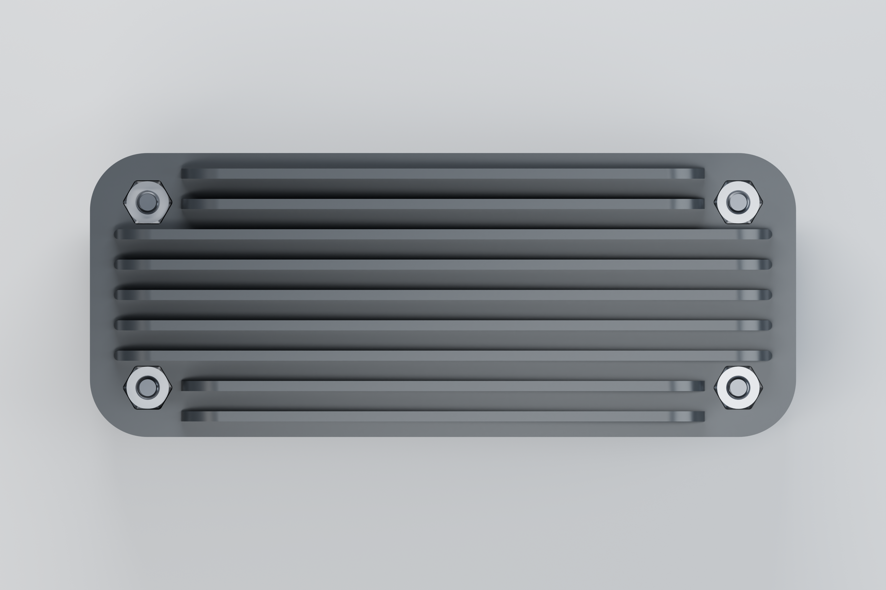
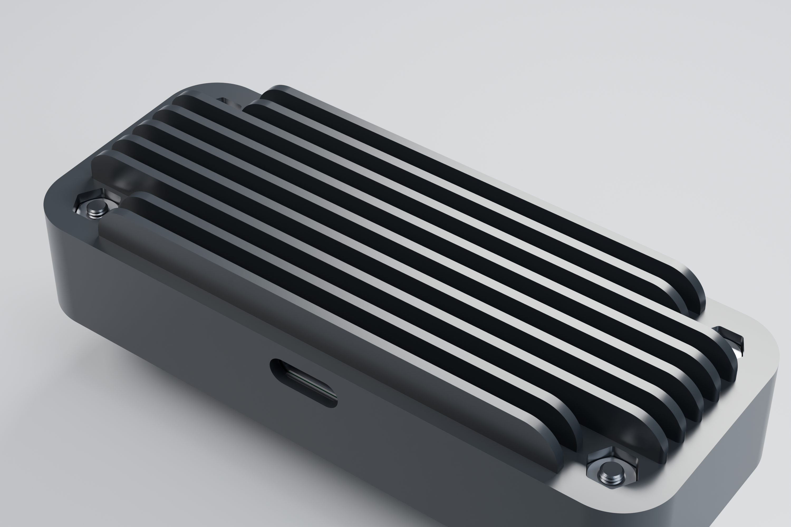
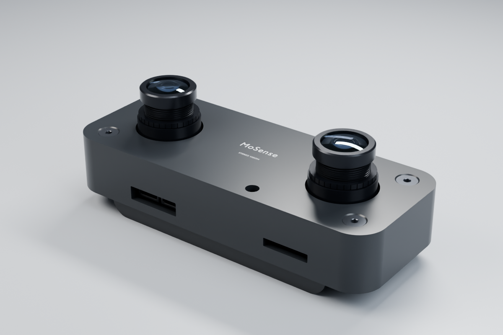

# MOHISM VINS

仅供学术交流和非商业用途，采用 CC BY-NC-SA 4.0授权协议，未经授权禁止商用。

MOHISM VINS 是一款双目视觉惯性设备。设备在板端计算深度和位姿，通过 USB 向笔记本提供图像、MAVLink 参数配置和调试终端。

仓库包含板级设备树、Buildroot 构建工程、IMU 内核驱动、视觉惯性算法、USB 复合设备配置和主机工具。


**USB 接口视角**



**散热结构**



**接口布局**



**结构爆炸图**



**USB 接口细节**



**散热鳍片轮廓**



**螺母安装槽**



**产品预览**



## 硬件与系统

| 项目 | 配置 |
| --- | --- |
| 双目相机 | 双路单色相机，原生分辨率 1280×800 |
| IMU | SPI 通信，数据就绪中断，驱动节点 `/dev/imu0` |
| USB | 一路 USB 2.0，工作在 Device 模式 |
| 系统 | Linux 5.10.160（PREEMPT_RT）+ Buildroot 2023.02.6 |
| 启动介质 | 当前工程使用 SD 卡 |

默认构建启用 PREEMPT_RT，IMU 的硬中断入口记录时间戳，SPI 读取在线程中执行。构建和测试方法见 [实时内核](docs/realtime.md)。

双目相机共用 FSIN 外触发，IMU INT1 提供数据就绪中断和时间戳。相机与 IMU 的共同事件同步方案见 [硬件核对](docs/hardware-review.md) 和 [同步方案](docs/hardware-sync.md)。

## USB 接口

连接笔记本后，固件将 USB 配置为一个复合设备，包含以下接口：

| 接口 | 用途 | 板端节点 |
| --- | --- | --- |
| UVC 双目 | 左右并排的灰度图 | 按 `uvc.stereo` 查找视频节点 |
| UVC 深度 | 独立的 16 位深度图 | 按 `uvc.depth` 查找视频节点 |
| CDC ACM | MAVLink 参数读写、状态和里程计 | `/dev/ttyGS0` |
| CDC ACM | Linux 日志和 Shell | `/dev/ttyGS1` |

Linux 主机上的串口通常为 `/dev/ttyACM0` 和 `/dev/ttyACM1`，视频节点为 `/dev/videoN`。编号会随连接顺序变化，使用前应确认接口身份。`lsusb` 显示一个物理设备，`lsusb -t` 可查看各接口的驱动。

U-Boot 也提供 USB CDC 调试控制台，进入 Linux 时 USB 会断开并重新枚举。DDR、SPL 等早期启动日志仍需通过 UART2 查看。连接方式见 [USB 调试串口](docs/usb-debug.md)。当前调试镜像的 root 用户未设置密码，发布前需要配置登录认证。

### 图像格式

设备提供两个独立的 UVC 视频功能，可分别打开：

| 视频流 | 格式 | 每帧字节数 | 默认请求帧率 |
| --- | --- | --- | --- |
| 双目 | 640×200 YUYV，左、右各占 320×200，色度固定 128 | 256000 | 60fps |
| 深度 | 320×200 Z16，小端 16 位整数，单位毫米 | 128000 | 30fps |

深度值 0 表示无效。主机工具将左右图保存为 8 位 PNG，深度保存为 16 位 PNG，分别写入 `stereo/` 和 `depth/`。两路独立计数，不能按文件名序号认定为同一次曝光；当前还没有共享帧号和曝光时间元数据。深度流保留最近一次计算结果，超过 200ms 没有发布结果时清零。具体格式见 [通信协议](docs/protocol.md)。

### 主机工具

以下示例使用 Linux 主机；请将串口和视频节点替换为实际设备。

```sh
python3 -m venv .venv
. .venv/bin/activate
pip install -r host/requirements.txt

# 读取和修改参数
python host/mohism.py --serial /dev/ttyACM0 params
python host/mohism.py --serial /dev/ttyACM0 set ACC_NOISE 0.15

# 接收状态和里程计
python host/mohism.py --serial /dev/ttyACM0 odometry

# 保存左右图和深度
python host/mohism.py images --stereo /dev/videoN --depth /dev/videoM --output capture --frames 100
```

## 算法

算法使用双目特征与 IMU 预积分共同求解位姿、速度、偏置和特征逆深度，后端为 Ceres 紧耦合滑窗，滑窗退出的状态通过 Schur 边缘化保留信息。初始化支持静止和具备足够运动的双目惯性对齐。

回环使用 ORB 检索、双目几何验证和重力约束的四自由度位姿图。地图可保存并在重启后重定位。外参和时间偏移支持在线估计，默认关闭，需要充分运动激励。地图修正或跟踪恢复可能改变输出坐标，主机应处理 MAVLink `reset_counter`。

EuRoC MH_01_easy 的离线回放有效率为 98.29%，发生 25 次重置或坐标修正计数变化。按连续有效段分别作 SE(3) 对齐后，位置 RMSE 为 0.060m。数据来源、评估方法及限制见 [算法验证](docs/vins-fusion-port.md)。

默认配置为 `calibrated: 0`，此时只提供原始双目预览和 MAVLink 控制，深度为零，不发送有效里程计。配置模板中的内外参是示例值，使用前必须替换为实测标定结果。

双目标定可使用 `host/calibrate_stereo.py`。相机与 IMU 的外参、轴向变换和时间偏移需要另外标定。完成后将配置放到板端 `/userdata/calibration.yml`，再启用标定状态并重启服务。步骤见 [构建与上板](docs/bringup.md)。

算法来源、合成回归测试和数据回放说明见 [算法移植记录](docs/vins-fusion-port.md)。

## 帧率与性能

开发配置位于板端 `/etc/mohism/performance.conf`：

```sh
CAPTURE_FPS=120
USB_FPS=60
DEPTH_FPS=30
```

以上分别设置双目采集、USB 输出和稠密深度的请求频率。相机驱动选择 SDK 中已有的 120 fps 模式；最终帧率还取决于外触发、曝光、双路采集、内存带宽和处理负载。

采集和处理使用有界队列，处理落后时保留最新帧。稀疏视觉跟踪与稠密深度分别调度，MAVLink 随新的有效估计发送。运行统计每 5 秒写入 `/run/mohism-status.json`。

双目 60fps 加深度 30fps 的纯图像数据量为 19.2 MB/s；两路均为 60fps 时为 23.04 MB/s。原生分辨率的高帧率双目图像不能直接通过当前 USB 链路无压缩输出。计算依据和统计口径见 [性能说明](docs/performance.md)。

## 构建

构建需要 Docker，以及下载依赖所需的网络访问。SDK、MAVLink 和 VINS-Fusion 的版本固定在 [sources.lock.json](sources.lock.json)。

在仓库根目录执行：

```sh
sh scripts/bootstrap.sh
sh scripts/build.sh environment
sh scripts/build.sh all
```

构建在容器内以当前用户运行，仓库挂载到 `/work`，支持宿主机路径包含中文和空格。脚本会清除影响工具运行的 AppImage 环境变量。

也可以分步运行：

| 命令 | 内容 |
| --- | --- |
| `sh scripts/build.sh host` | 主机编译和回归测试 |
| `sh scripts/build.sh sanitize` | ASan / UBSan 检查 |
| `sh scripts/build.sh arm-check` | QEMU 下运行 ARM 数值与地图测试 |
| `sh scripts/build.sh kernel` | PREEMPT_RT 内核、设备树和 IMU 驱动 |
| `sh scripts/build.sh kernel-standard` | 单独构建普通内核，用于回退比较 |
| `sh scripts/build.sh uboot` | U-Boot |
| `sh scripts/build.sh rootfs` | Buildroot 根文件系统 |
| `sh scripts/build.sh refresh-rootfs` | 修改应用源码后清理本地包并重建根文件系统 |
| `sh scripts/build.sh package` | 打包镜像并执行离线检查 |

修改用户态源码后，使用 `refresh-rootfs`，再执行 `package`，避免 Buildroot 复用旧的本地包。

### 构建产物

产物位于 `out/artifacts/`，该目录不提交到 Git。

| 文件 | 内容 |
| --- | --- |
| `mohism-sd.img` | 完整 SD 卡镜像 |
| `boot.img` | 内核与设备树 FIT 镜像 |
| `uboot.img` | U-Boot 镜像 |
| `rootfs.img` | 根文件系统 |
| `mohism_imu.ko` | IMU 内核模块 |
| `mohism-vins` | ARM 用户态程序 |
| `mohism-vins-source.tar.gz` | 对应源码归档 |
| `SHA256SUMS` | 产物校验值 |

目录中还包含 DDR/SPL idblock 和 USB 下载 loader。SD 镜像采用 ENV 与固定偏移布局，没有传统 MBR/GPT 分区表。写卡和恢复流程请按 [上板文档](docs/bringup.md) 操作。

## 后续计划

后续计划通过 SDIO Wi-Fi 发送板端硬件编码的 H.264 预览。深度数值单独传输，USB 接口保留。

共同同步、标定与无线视频的开发清单见 [TASKS.md](TASKS.md)，交付要求见 [固件交付与测试](docs/product-delivery.md)。

## 文档与许可证

- [构建、写卡与首次启动](docs/bringup.md)
- [硬件核对](docs/hardware-review.md)
- [相机与 IMU 同步](docs/hardware-sync.md)
- [IMU 驱动接口](docs/imu-driver.md)
- [USB 与 MAVLink 协议](docs/protocol.md)
- [USB 调试串口](docs/usb-debug.md)
- [算法移植记录](docs/vins-fusion-port.md)
- [性能说明](docs/performance.md)
- [实时内核](docs/realtime.md)

原创硬件与文档采用 [CC BY-NC-SA 4.0](LICENSES/CC-BY-NC-SA-4.0.txt)，用户态软件采用 [GPL-3.0](LICENSE)。内核驱动和板级文件按各文件声明授权，第三方内容保留原有许可证。适用范围见 [许可说明](LICENSING.md)，VINS-Fusion 来源见 [第三方声明](third_party/VINS-Fusion/NOTICE.md)。
